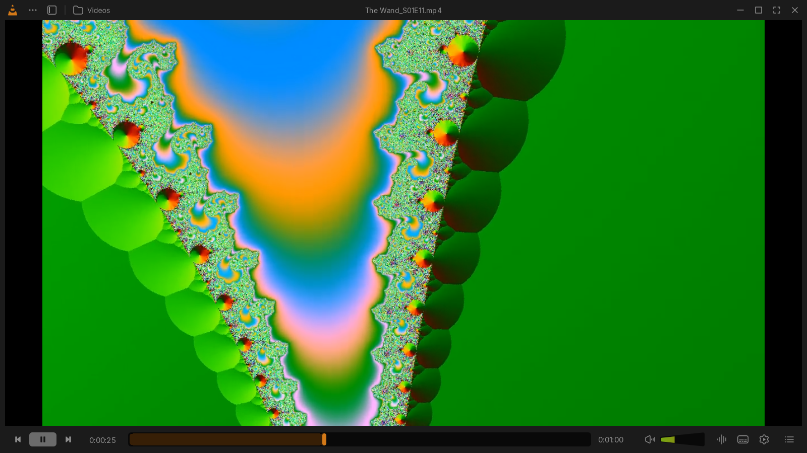
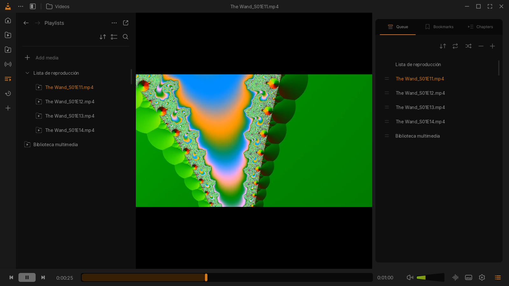
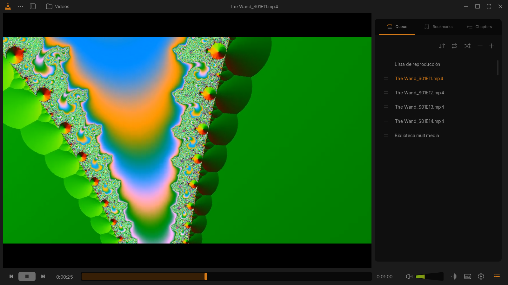
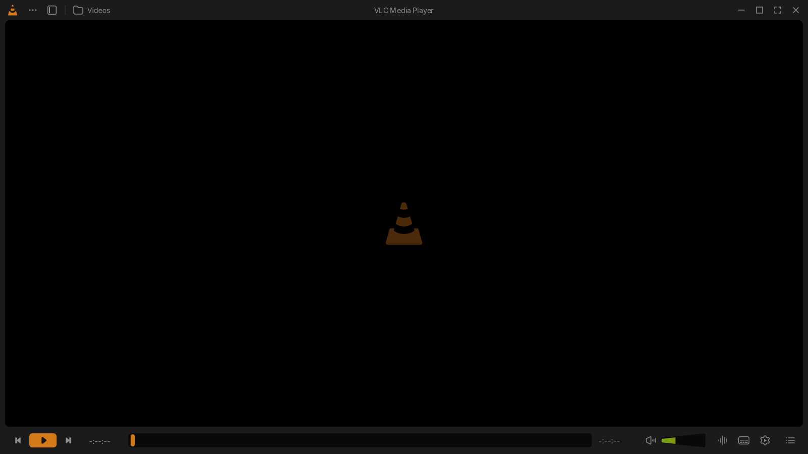

# VLC Redesign: a skin for VLC 3

A skin for **VLC 3.0** (Skins2 interface) that implements the VLC redesign created by **[Juxtopposed](https://www.figma.com/@juxtopposed)**.



## Design credits

The original design is **not mine**. It was created by **Juxtopposed** and published on the Figma Community:

- **Design:** [VLC Redesign, by Juxtopposed](https://www.figma.com/community/file/1691465999134370980/vlc-redesign)
- **Video presenting the redesign:** https://youtu.be/ERFeOgqk324
- **Design license:** [CC BY 4.0](https://creativecommons.org/licenses/by/4.0/)

This repository only **implements that design** as a skin you can use in VLC 3 today. All the visual credit (colors, typography, iconography and layout) goes to Juxtopposed. The work here was translating the Figma file into a working skin as faithfully as possible: colors, measurements and icons were taken directly from the Figma file.

## Screenshots

| Sidebar and queue | Queue |
|---|---|
|  |  |

| Idle |
|---|
|  |

## Installation

1. Download [`VLCRedesign.vlt`](https://github.com/SrPio/vlc-redesign-skin/releases/latest/download/VLCRedesign.vlt) (also available in [`dist/`](dist/)).
2. Copy it to the VLC skins folder:
   - Windows: `%APPDATA%\vlc\skins\`
   - Linux: `~/.local/share/vlc/skins2/`
3. In VLC go to **Tools → Preferences → Interface**, select **Use custom skin** and choose `VLCRedesign.vlt`.
4. Restart VLC.

To go back to the regular interface, select **Use native style** on the same screen.

> Tested on VLC 3.0.23 for Windows. Skins2 is not available on macOS.

## Features

- **Title bar:** menu (⋯), sidebar toggle, folder shortcut, title of the current media and window buttons. The window can be dragged from anywhere on the bar.
- **Controls bar:** play/pause, seek bar, wedge-shaped volume slider with gradient, audio, video/subtitles and playback menus, and queue toggle.
- **Sidebar:** icon rail (open file, folder, disc, network, playlist and more) and a panel with the playlist and media library tree.
- **Queue panel:** playlist with sort, repeat, shuffle, remove and add.
- **Fullscreen:** bottom controls bar.
- The window can be resized from the right edge, the bottom edge and the bottom-right corner.

## Limitations

Skins2, VLC 3's skinning system, has limits that make some parts of the design impossible to reproduce:

- Dialogs (onboarding, "Customize Player", preferences, etc.) are native VLC windows and cannot be skinned.
- Lists cannot show thumbnails, durations or the "4 items - 2h 3m" counter.
- The Bookmarks and Chapters tabs are visual only.
- Video is rendered in a native window, so the queue panel sits next to the video instead of floating over it.
- The window can only be resized from the right and the bottom.
- "Create playlist" is shown as "Add media", because VLC 3 does not support empty playlists.

## Contributing

This project is **open source** and improvements are welcome: better fidelity to the design, fixes, support for other platforms, tooltip translations, and so on. Open an issue or send a pull request.

### Building from source

Requires [Node.js](https://nodejs.org) and [pnpm](https://pnpm.io).

```bash
pnpm install
pnpm run build
```

This produces `dist/VLCRedesign.vlt`. Project structure:

| Path | Contents |
|---|---|
| `tools/spec.mjs` | Colors, measurements and tokens taken from the Figma file |
| `tools/build-font.mjs` | Inter variant with adjusted metrics to vertically center list text |
| `tools/build-assets.mjs` | Generates every skin image into `skin/images/` |
| `tools/build-theme.mjs` | Generates `skin/theme.xml` (the 4 window layouts and the fullscreen controller) |
| `tools/pack.mjs` | Packs `skin/` into the `.vlt` file |
| `tools/figma-export.mjs` | Re-exports icons and renders from Figma (optional) |
| `design/icons`, `design/reference` | SVG icons and renders exported from Juxtopposed's design |

To re-export from Figma, duplicate the [community file](https://www.figma.com/community/file/1691465999134370980/vlc-redesign) into your account and run:

```bash
FIGMA_TOKEN=<your personal access token> FIGMA_FILE_KEY=<key of your copy> pnpm run figma
```

## License

- **Code:** [MIT](LICENSE).
- **Design, icons and renders** (`design/`): © Juxtopposed, under [CC BY 4.0](https://creativecommons.org/licenses/by/4.0/).
- **Inter font:** [SIL Open Font License 1.1](skin/fonts/Inter-LICENSE.txt).

VLC and the VLC cone are trademarks of VideoLAN. This project is not affiliated with or endorsed by VideoLAN.
